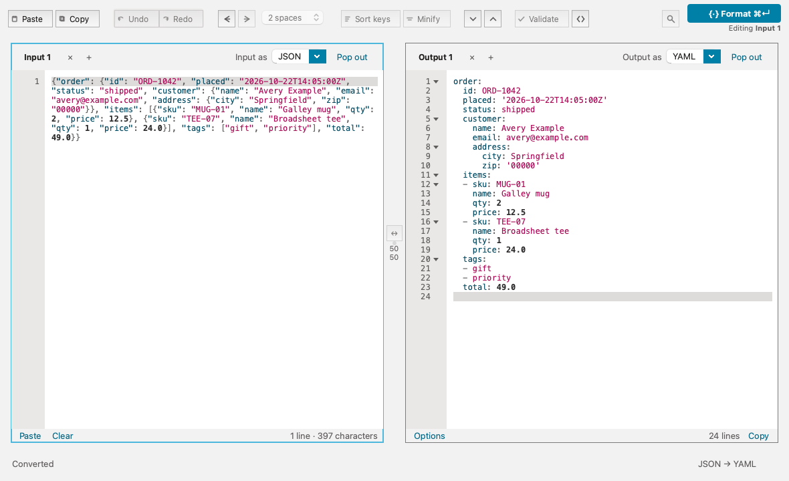
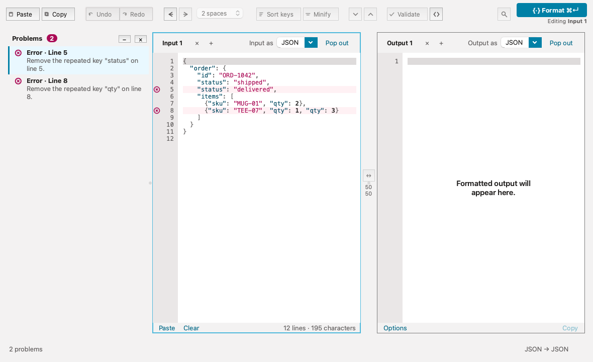
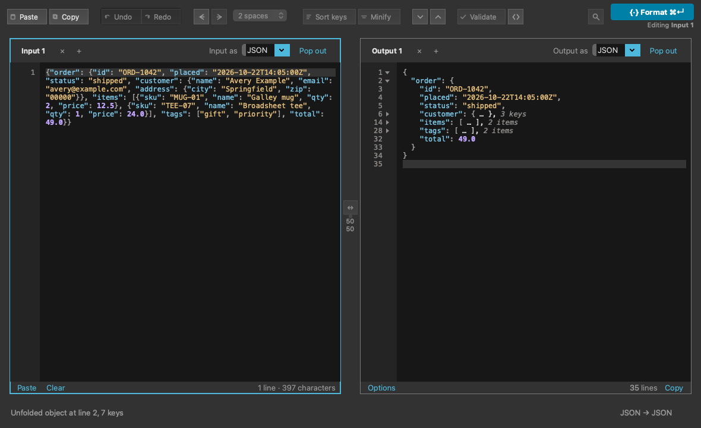
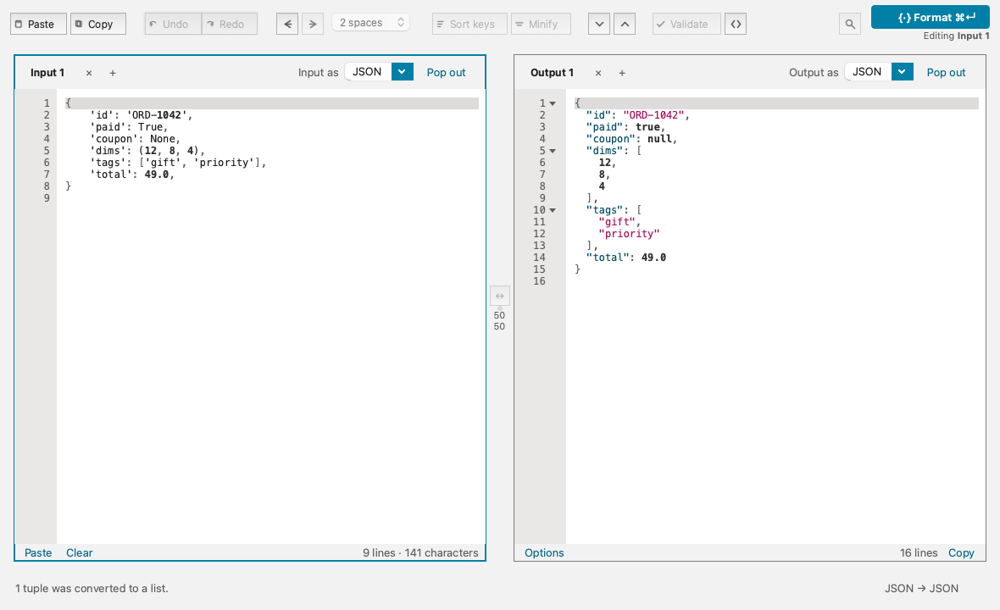

# Galley

Galley is a desktop app for formatting, validating, and converting JSON and YAML. Paste text or open a file, and Galley gives you clean output, plain-language errors that point at the exact line, and a Convert from Python that never runs your code. It's built with Qt 6 and PySide6, with a print-inspired design.



Galley is in active development and hasn't had a release yet. The [roadmap](#roadmap) lists what's still coming.

## What it does

- **Format and convert.** Pick the Input format and the Output format, then press Format. JSON to JSON, YAML to YAML, JSON to YAML and YAML to JSON all work. Input is never changed, and each result lands in Output as one undo step.
- **Point at the problem.** Errors open the Problems pane, with one row per error and a marker in the gutter on the line to fix. The messages are plain sentences, such as "Remove the repeated key "status" on line 5." Repeated JSON keys are reported as errors, where most parsers silently keep only the last value.
- **Fold big documents.** Collapse objects and arrays in Output from the gutter, the View menu, or the keyboard. A folded line shows a summary such as `{ … }, 3 keys`. Collapse all and Expand all work across the whole document, and copying always gives the full text.
- **Convert from Python.** Paste a Python literal (a dict or list with `True`, `None`, tuples and so on) and get JSON or YAML. Galley reads it with Python's `ast` module. It never runs the text.
- **Escape and unescape strings.** Turn a document into one escaped JSON string, or turn an escaped string back into formatted JSON or YAML.
- **Stay responsive on large files.** Formatting runs in a separate process. A spinner and a progress bar appear for long jobs, and Cancel stops the job right away and puts the previous result back. Very long single lines turn off whitespace dots and syntax colors so typing stays fast.
- **Light, Dark, or System.** View › Appearance follows macOS or stays fixed. Every color is tested for contrast in both modes, and color is never the only cue.
- **The small things.** Open files up to 100 MB, Show Whitespace, Word Wrap, bigger and smaller text, and Stack Panes to put Input above Output.

| | |
|---|---|
|  |  |
| Errors go to the Problems pane, with a marker on each line to fix. | Folded Output in dark mode. |



*Convert from Python. The status bar notes that the tuple became a list.*

## Keyboard shortcuts

| Command | macOS | Windows and Linux |
|---|---|---|
| Format | ⌘↵ | Ctrl+Enter |
| Open file | ⌘O | Ctrl+O |
| Show Problems | ⇧⌘M | Ctrl+Shift+M |
| Fold / Unfold | ⌥⌘[ / ⌥⌘] | Ctrl+Shift+[ / Ctrl+Shift+] |
| Collapse all / Expand all | ⌘K ⌘0 / ⌘K ⌘J | Ctrl+K, Ctrl+0 / Ctrl+K, Ctrl+J |
| Escape as String | ⇧⌘E | Ctrl+Shift+E |
| Unescape String | ⌘K ⌘E | Ctrl+K, Ctrl+E |
| Word Wrap | ⌥Z | Alt+Z |
| Show Whitespace | ⇧⌘8 | Ctrl+Shift+8 |
| Stack Panes | ⌘\\ or ⇧⌘L | Ctrl+\\ or Ctrl+Shift+L |
| Bigger / Smaller / Actual Size | ⌘+ / ⌘− / ⌘0 | Ctrl++ / Ctrl+− / Ctrl+0 |

No shortcut uses Ctrl+Alt on Windows, because AltGr acts as Ctrl+Alt there and would trigger commands while you type characters such as `[` or `€`.

## Roadmap

Menu items and toolbar buttons that aren't built yet are disabled and say "Coming soon", so nothing pretends to work. Galley won't be released while any remain. Still to come:

- Find, Find and Replace, and key-only search
- Sort keys, Minify, Validate, and indent size
- Open Recent and drag and drop to open
- Copy As (original, masked, or random fake values) and masking of sensitive values
- Every JSON error in one pass, not just the first
- Comparing two documents side by side
- HTML and XML formatting
- Tabs, indent guides, and pop-out windows
- Windows builds

Specs for each feature live in their [GitHub issues](https://github.com/ericpeck/galley/issues).

## Install the macOS app

Galley runs on macOS 14 (Sonoma) or later, on Apple Silicon. The Release macOS workflow builds an unsigned disk image; see [docs/releasing.md](docs/releasing.md). The app has no Developer ID signature and isn't notarized, so macOS asks once before it opens:

1. Drag Galley to Applications.
2. Open it once and dismiss the warning.
3. Go to System Settings › Privacy & Security, scroll down to Security, and click Open Anyway next to the message about Galley. It asks for your password.

After that, Galley opens with a normal double-click. On macOS 14 and earlier, right-click › Open also works.

## Run from source

You need [uv](https://docs.astral.sh/uv/getting-started/installation/). Galley uses Python 3.12.

```sh
uv sync
```

```sh
uv run galley
```

- If `uv` isn't found after installing it, open a new terminal so your PATH reloads.
- If `uv sync` says Python 3.12 is missing, run `uv python install 3.12`, then `uv sync` again.
- If `uv run galley` reports a missing module, run `uv sync` again.

## Development

Run the tests. They set `QT_QPA_PLATFORM=offscreen`, so no display is needed:

```sh
uv run pytest
```

Lint and check formatting:

```sh
uv run ruff check
```

```sh
uv run ruff format --check
```

The release check lists every action that still says "Coming soon" or "Not yet", and exits with an error until both lists are empty:

```sh
uv run python -m galley.app.actions
```

Read [AGENTS.md](AGENTS.md) before contributing. It covers the layout (`galley.core` never imports Qt), the merge rules, colors and contrast, cross-platform shortcuts, and what must never be committed to this public repository. Design references:

- [docs/ui-spec.md](docs/ui-spec.md): screens, states, wording, and keyboard paths
- [docs/adr/0001-core-architecture.md](docs/adr/0001-core-architecture.md): the worker process, Cancel, and size bands
- [docs/releasing.md](docs/releasing.md): building the disk image

## Privacy

Galley works offline. It has no network code, and it never runs the text you give it. Settings stay on your computer.

## Third-party licenses

Licenses for Qt, PySide6, Python, ruamel.yaml and the other bundled components are in [LICENSES/](LICENSES/).
